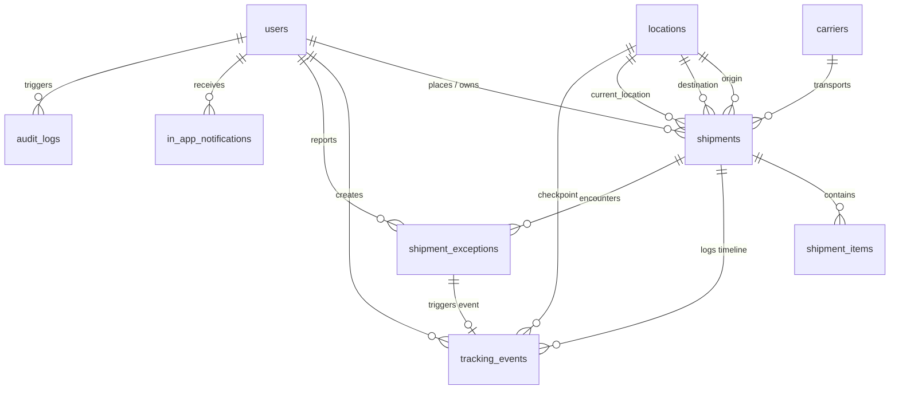

# CargoTrace — Entity Relationship Diagram & Data Dictionary

## 📊 Entity Relationship Diagram (ERD)

---

## 🔗 Cardinality & Design Decisions

### 1. `users` $\longleftrightarrow$ `shipments` (One-to-Many)
- **Design Decision:** A customer user can own multiple consignments over time (`hasMany`), but each consignment strictly belongs to exactly one customer entity (`belongsTo`).
- **Authorization Purpose:** Used by Eloquent query scopes to restrict customers to viewing only their own shipments (`WHERE customer_id = ?`).

### 2. `carriers` $\longleftrightarrow$ `shipments` (One-to-Many)
- **Design Decision:** A carrier (e.g. Maersk, DHL) operates many shipments. Foreign key `carrier_id` with `ON DELETE RESTRICT` guarantees that carrier records cannot be orphaned while active cargo is in transit.

### 3. `locations` $\longleftrightarrow$ `shipments` (Multiple One-to-Many Foreign Keys)
- **Design Decision:** A single shipment references the `locations` table three distinct times:
  - `origin_id`: Departure port/hub.
  - `destination_id`: Destination port/hub.
  - `current_location_id` (Nullable): Dynamically updated to point to the latest recorded physical checkpoint.

### 4. `shipments` $\longleftrightarrow$ `shipment_items` (One-to-Many)
- **Design Decision:** A shipment manifest is broken down into itemized line entries with individual SKU, package types, weight, and declared value.

### 5. `shipments` $\longleftrightarrow$ `tracking_events` (One-to-Many, Append-Only)
- **Design Decision:** Tracking events are strictly additive and immutable. When a new checkpoint is reached, a new record is inserted with `event_time`, `latitude`, `longitude`, and `description`. Old events are never overwritten.

### 6. `shipments` $\longleftrightarrow$ `shipment_exceptions` (One-to-Many)
- **Design Decision:** Operational disruptions (`CUSTOMS_HOLD`, `WEATHER_DELAY`, etc.) are tracked as discrete exception entities with their own lifecycle status (`OPEN`, `INVESTIGATING`, `RESOLVED`) and resolution timestamps.

---

## 📖 Data Dictionary

### Table: `users`
| Column | Type | Constraints | Description |
| :--- | :--- | :--- | :--- |
| `id` | BIGINT UNSIGNED | PK, Auto Inc | Unique user ID |
| `name` | VARCHAR(255) | NOT NULL | User's full name |
| `email` | VARCHAR(255) | UNIQUE, NOT NULL | Login email address |
| `password` | VARCHAR(255) | NOT NULL | Bcrypt hashed password |
| `role` | VARCHAR(20) | NOT NULL, DEFAULT 'CUSTOMER' | Enum: `ADMIN`, `OPERATOR`, `CUSTOMER` |
| `phone` | VARCHAR(50) | NULLABLE | Contact telephone |
| `company_name`| VARCHAR(150) | NULLABLE | Organization / Corporate identity |
| `created_at` / `updated_at` | TIMESTAMP | NULLABLE | Standard timestamps |

### Table: `carriers`
| Column | Type | Constraints | Description |
| :--- | :--- | :--- | :--- |
| `id` | BIGINT UNSIGNED | PK, Auto Inc | Unique carrier ID |
| `code` | VARCHAR(20) | UNIQUE, NOT NULL | Carrier standard code (e.g., `MSK`, `CMA`) |
| `name` | VARCHAR(100) | NOT NULL | Carrier corporate name |
| `service_type`| VARCHAR(20) | NOT NULL | Mode: `OCEAN`, `AIR`, `LAND`, `MULTIMODAL` |
| `contact_email`| VARCHAR(150) | NULLABLE | Operational contact |
| `is_active` | BOOLEAN | DEFAULT TRUE | Carrier operational status |

### Table: `locations`
| Column | Type | Constraints | Description |
| :--- | :--- | :--- | :--- |
| `id` | BIGINT UNSIGNED | PK, Auto Inc | Unique location ID |
| `code` | VARCHAR(20) | UNIQUE, NOT NULL | UN/LOCODE or IATA code (e.g. `IDJKT`, `NLRTM`) |
| `name` | VARCHAR(150) | NOT NULL | Facility or port name |
| `city` | VARCHAR(100) | NOT NULL | City name |
| `country` | VARCHAR(100) | NOT NULL | Country name or ISO code |
| `latitude` | DECIMAL(10, 7) | NOT NULL | Geographic latitude |
| `longitude`| DECIMAL(10, 7) | NOT NULL | Geographic longitude |

### Table: `shipments`
| Column | Type | Constraints | Description |
| :--- | :--- | :--- | :--- |
| `id` | BIGINT UNSIGNED | PK, Auto Inc | Unique shipment primary key |
| `shipment_number` | VARCHAR(40) | UNIQUE, INDEX | Business tracking code (e.g., `CT-2026-EU01`) |
| `customer_id` | BIGINT UNSIGNED | FK (`users.id`) | Consignee / client |
| `carrier_id` | BIGINT UNSIGNED | FK (`carriers.id`) | Transport provider |
| `origin_id` | BIGINT UNSIGNED | FK (`locations.id`) | Port/hub of origin |
| `destination_id` | BIGINT UNSIGNED | FK (`locations.id`)| Final destination port/hub |
| `current_location_id` | BIGINT UNSIGNED | FK (`locations.id`), NULLABLE | Current physical position |
| `cargo_type` | VARCHAR(60) | NOT NULL | Commodity category |
| `total_weight_kg` | DECIMAL(10, 2) | DEFAULT 0.00 | Total gross weight |
| `total_volume_cbm` | DECIMAL(10, 2) | DEFAULT 0.00 | Total gross volume |
| `current_status` | VARCHAR(30) | INDEX | State: `CREATED`, `BOOKED`, `PICKED_UP`, `IN_TRANSIT`, `DELIVERED` |
| `expected_departure` | DATETIME | NOT NULL | SLA departure date/time |
| `actual_departure` | DATETIME | NULLABLE | Recorded departure date/time |
| `expected_arrival` | DATETIME | NOT NULL | SLA expected destination date/time |
| `estimated_arrival` | DATETIME | NOT NULL | Recalculated dynamic ETA |
| `actual_arrival` | DATETIME | NULLABLE | Final delivered date/time |
| `is_delayed` | BOOLEAN | INDEX, DEFAULT FALSE | Whether ETA > expected arrival |
| `delay_duration_minutes` | INT | DEFAULT 0 | Delay magnitude in minutes |
| `delay_severity` | VARCHAR(20) | INDEX | `NONE`, `LOW`, `MEDIUM`, `HIGH` |
| `delay_reason` | VARCHAR(255) | NULLABLE | Deterministic diagnostic explanation |
| `notes` | TEXT | NULLABLE | Operational remarks |
| `deleted_at` | TIMESTAMP | NULLABLE | Soft delete timestamp |

### Table: `tracking_events`
| Column | Type | Constraints | Description |
| :--- | :--- | :--- | :--- |
| `id` | BIGINT UNSIGNED | PK, Auto Inc | Unique event ID |
| `shipment_id` | BIGINT UNSIGNED | FK (`shipments.id`) | Linked shipment |
| `location_id` | BIGINT UNSIGNED | FK (`locations.id`), NULLABLE | Physical location record |
| `created_by` | BIGINT UNSIGNED | FK (`users.id`) | Operator identity who logged event |
| `event_status` | VARCHAR(30) | INDEX | Shipment status at this moment |
| `event_type` | VARCHAR(30) | INDEX | `NORMAL`, `CHECKPOINT`, `DEPARTURE`, `ARRIVAL`, `EXCEPTION` |
| `event_time` | DATETIME | INDEX | Chronological event timestamp |
| `location_name` | VARCHAR(150) | NOT NULL | Readable location label |
| `latitude` | DECIMAL(10, 7) | NULLABLE | Lat coordinate |
| `longitude`| DECIMAL(10, 7) | NULLABLE | Lng coordinate |
| `description` | TEXT | NOT NULL | Detailed operational notes |
| `exception_id` | BIGINT UNSIGNED | FK (`shipment_exceptions.id`), NULLABLE | Tied exception incident |

### Table: `shipment_exceptions`
| Column | Type | Constraints | Description |
| :--- | :--- | :--- | :--- |
| `id` | BIGINT UNSIGNED | PK, Auto Inc | Unique exception ID |
| `shipment_id` | BIGINT UNSIGNED | FK (`shipments.id`) | Linked shipment |
| `reported_by` | BIGINT UNSIGNED | FK (`users.id`) | Operator reporting issue |
| `exception_type` | VARCHAR(40) | NOT NULL | `CUSTOMS_HOLD`, `WEATHER_DELAY`, `PORT_CONGESTION`, etc. |
| `severity` | VARCHAR(20) | NOT NULL | `LOW`, `MEDIUM`, `HIGH`, `CRITICAL` |
| `status` | VARCHAR(20) | NOT NULL | `OPEN`, `INVESTIGATING`, `RESOLVED` |
| `description` | TEXT | NOT NULL | Incident narrative |
| `detected_at` | DATETIME | NOT NULL | Timestamp when issue occurred |
| `resolved_at` | DATETIME | NULLABLE | Timestamp when issue was cleared |
| `resolution_notes` | TEXT | NULLABLE | Corrective action taken |
